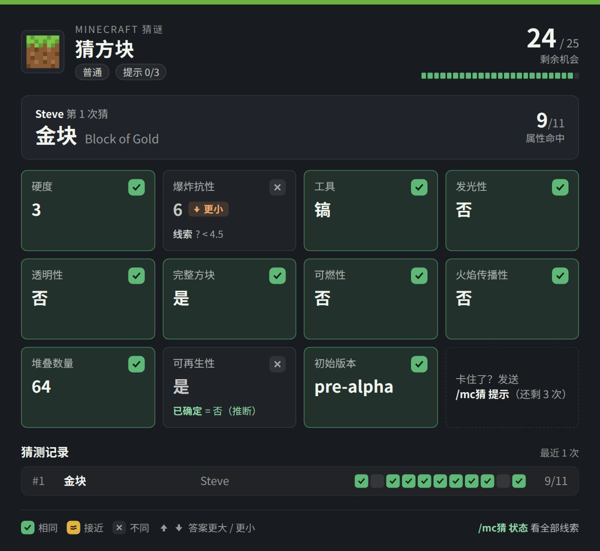
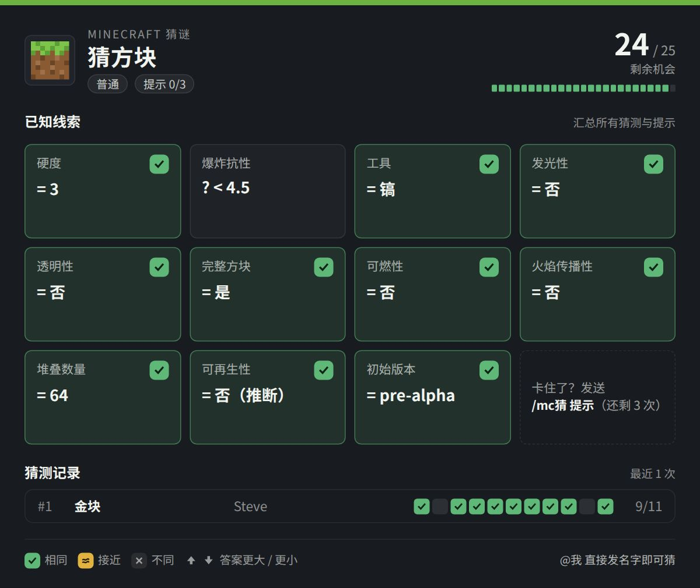
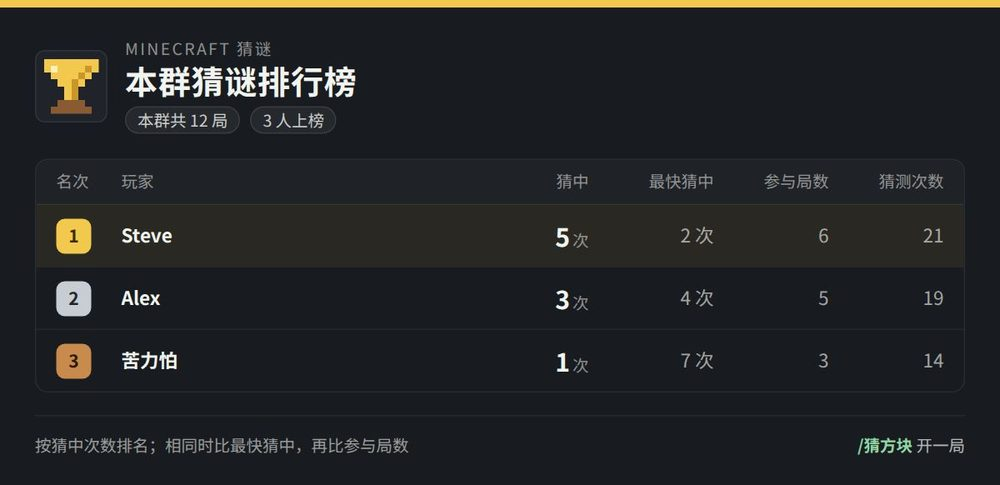
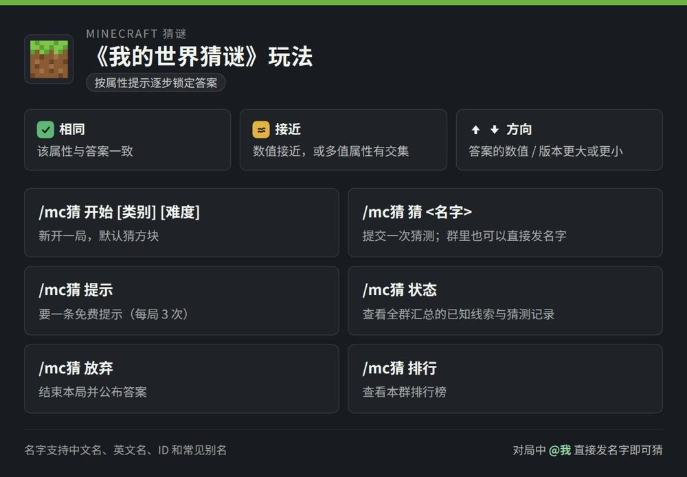

# 我的世界·猜谜（MCGuess）

[](https://github.com/AstrBotDevs/AstrBot)
[](LICENSE)

在聊天里玩《我的世界》猜谜：每次猜一个**方块 / 物品 / 生物**，按属性对比逐步锁定答案。支持群聊协作、免费提示、排行榜、自然语言和本地渲染的卡片。



## 特性

- **Wordle 式反馈**：11 项属性逐项对比，相同 / 接近 / 不同，数值还会提示「答案更大 / 更小」。
- **全群协作**：所有人的猜测共享线索，`/mc猜 状态` 自动汇总每个属性的已知范围。
- **免命令直猜**：对局中直接发名字即可；群聊默认免 @（整句精确词条名或「我猜X」）。
- **25 次机会**、每局 3 次免费提示，难度分简单 / 普通 / 困难。
- **排行榜**：按群统计猜中次数、最快猜中、参与局数。
- **自然语言**：LLM 工具支持「我要猜个方块」「还剩几次」「给个提示」。
- **本地渲染**：Playwright 本地截图，热态约 0.1 秒；失败自动回退远端 / 纯文本。
- 词库 296 方块 / 195 物品 / 84 生物，含中英文别名，运行时零联网。

## 指令

| 指令 | 说明 |
| --- | --- |
| `/mc猜 开始 [方块\|物品\|生物] [简单\|普通\|困难]` | 开一局 |
| `/猜方块`、`/猜物品`、`/猜生物` | 直接开对应类别（可带难度） |
| `/mc猜 猜 <名字>`；或对局中直接发名字 | 提交猜测 |
| `/mc猜 提示` | 免费提示（每局 3 次） |
| `/mc猜 状态` | 已知线索 + 猜测记录 |
| `/mc猜 放弃` | 结束并公布答案 |
| `/mc猜 排行` | 本群排行榜 |
| `/mc猜 帮助` | 玩法说明卡片 |

## 卡片预览

| 线索卡（状态 / 放弃） | 排行卡 |
| --- | --- |
|  |  |



## 安装

把本目录放进 AstrBot 的 `data/plugins/astrbot_plugin_mcguess/`，在 WebUI 重载插件；AstrBot 会按 `requirements.txt` 安装 `playwright`。

要让本地渲染生效，再装一次 Chromium（不装也能用，会自动回退远端 / 文本）：

```bash
.venv/bin/python -m playwright install chromium
```

## 配置

配置文件：`data/config/astrbot_plugin_mcguess_config.json`（也可在 WebUI 修改）。

| 配置 | 默认 | 说明 |
| --- | --- | --- |
| `max_attempts` | `25` | 每局机会数（3-50） |
| `hint_limit` | `3` | 免费提示次数，`0` 关闭 |
| `render_cards` | `true` | 图片卡片开关 |
| `render_backend` | `auto` | `auto` / `local` / `remote` |
| `render_scale` | `1.5` | 本地渲染倍率（0.5-2.0） |
| `group_guess_without_at` | `true` | 群聊免 @ 直猜 |
| `llm_tool_enabled` | `true` | 注册 LLM 工具 `mc_guess` |
| `idle_timeout_minutes` | `30` | 闲置自动结束，`0` 不限制 |

<details>
<summary>全部配置项</summary>

| 配置 | 默认 | 说明 |
| --- | --- | --- |
| `card_image_format` | `jpeg` | 卡片格式：`jpeg` 体积小、`png` 最锐利 |
| `card_image_quality` | `80` | JPEG 质量（30-95） |
| `browser_path` | 空 | Chromium 路径；留空用 `playwright install` 的浏览器 |
| `local_render_timeout_seconds` | `20.0` | 本地渲染超时（含首次启动浏览器） |
| `remote_render_fallback` | `true` | 本地失败时回退远端 html_render |
| `render_timeout_seconds` | `15.0` | 远端回退渲染超时 |
| `free_text_guess` | `true` | 对局中直接发名字即算猜测 |
| `llm_tool_cards_only` | `true` | LLM 调用时只发卡片，不再请求模型补文字 |
| `require_finish_in_group` | `true` | 群聊中上一局未结束时不允许开新局 |

</details>

<details>
<summary>反馈含义、属性维度与词库</summary>

| 符号 | 含义 |
| --- | --- |
| 🟩 | 与答案完全一致 |
| 🟨 | 部分符合（多值属性有交集）或数值接近 |
| ⬜ | 不一致 |
| ⬆ / ⬇ | 数值类属性：答案比猜测更大 / 更小 |

- 多值属性（获得方式、用途、生成方式、生物分类等）按集合比较，有交集标 🟨 并列出命中项。
- 数值带容差：硬度 ±0.5、爆炸抗性相对 25%、生命值 ±2、体型高度 ±0.1；堆叠数量要求精确。
- 「初始版本」按先后比较，同一大版本（`1.16` 与 `1.16.2`、`Alpha 1.0.x`）判 🟨。

| 类别 | 维度 |
| --- | --- |
| 方块 | 硬度、爆炸抗性、工具、发光性、透明性、完整方块、可燃性、火焰传播、堆叠数量、可再生性、初始版本 |
| 物品 | 稀有度、堆叠数量、可再生性、获得方式、用途、库存类别、合成方式、掉落方式、初始版本 |
| 生物 | 生命值、体型高度、行为、生成方式、分类、初始版本 |

词库随插件分发（Minecraft 1.21.9，运行时零联网）：

| 类别 | 词条 | 简单池 | 普通池 | 困难池 |
| --- | --- | --- | --- | --- |
| 方块 | 296 | 75 | 227 | 279 |
| 物品 | 195 | 87 | 186 | 191 |
| 生物 | 84 | 51 | 76 | 81 |

另有 267 条别名（中英文、常见口语/错写）与 50 个版本；24 个技术/不可获得词条只能被猜、不会成为答案。

</details>

<details>
<summary>开发、模块与已知限制</summary>

```bash
# 在仓库根目录（本插件的上一级）运行
python -m pytest astrbot_plugin_mcguess/tests
python -m ruff check astrbot_plugin_mcguess

# 重新生成词库（离线，输入在 tools/mcdle_raw/）
python astrbot_plugin_mcguess/tools/build_catalog.py
```

| 文件 | 职责 |
| --- | --- |
| `main.py` | 插件入口：命令解析、自由文本、LLM 工具、卡片/文本回复 |
| `core.py` | 纯玩法逻辑：属性比较、回合状态机、提示生成、线索汇总 |
| `catalog.py` | 词库加载、校验、中英文/别名解析 |
| `game_service.py` | 每会话对局持久化、超时、排行榜统计 |
| `card_renderer.py` | HTML 卡片模板（stdlib only） |
| `card_views.py` | 把存档对局转换成卡片数据 |
| `renderer.py` | 本地 Playwright 渲染：浏览器生命周期与截图 |
| `render_service.py` | 渲染调度：后端选择、超时、熔断、远端回退 |
| `llm_tool.py` | LLM 工具参数校验与 JSON 结果 |

- 群聊免 @ 直猜依赖全消息监听；若该群禁用了本插件或其它插件先 `stop_event`，请改用 @机器人。
- 排行榜按群统计，用发送者 ID 识别玩家，改昵称不丢记录；v1.4.0 之前完成的对局不计入。
- 词库按「概念级词条」组织（如「门」「原木」），不区分具体变种。
- 本地渲染首次使用需启动 Chromium（约 1–2 秒），之后复用；未安装浏览器或字体时自动回退。
- 图片卡片能否发送取决于平台是否支持图片消息。

</details>

## 兼容性

- AstrBot `>=4.16,<5`（在 4.29.3 上验证），Python 3.10+
- 平台：aiocqhttp / Telegram / Discord 等（图片与 @ 能力取决于平台适配器）

## 数据与许可

- 词条数据整理自 [Minecraft Wiki](https://minecraft.wiki/)（CC BY-NC-SA 系），初始数据参考 [koishi-plugin-mcdle](https://github.com/araea/koishi-plugin-mcdle)（MIT OR Apache-2.0）。
- 本项目与 Mojang / Microsoft 无关，是非官方同人作品；**因数据含 CC BY-NC-SA 内容，请勿用于商业用途**。
- 代码以 MIT 许可证发布，见 [LICENSE](LICENSE)。

更新日志见 [CHANGELOG.md](CHANGELOG.md)。
